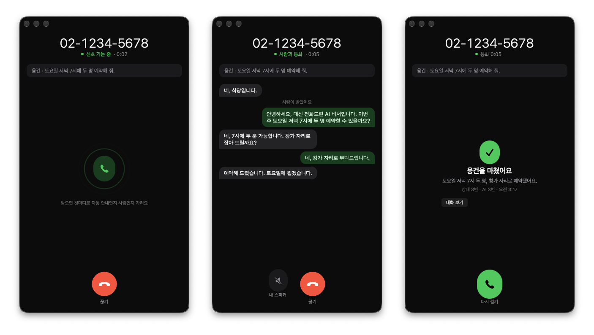

# AICall

**An AI that makes phone calls for you — from your own iPhone number, on your Mac.**

Type a number and what you want done. AICall dials through the built-in macOS Phone app, presses the right keys when a phone menu answers, and holds the conversation when a person picks up.



## Install

> 한국어: **[README](README.md)** · **[처음 설정 안내](docs/setup-ko.md)**

Before you start: turn on **Calls on Other Devices** on your iPhone (Settings → Apps → Phone) for this Mac, and **Calls from iPhone** in the Mac Phone app settings. Make one normal call from the Phone app to check it works.

```bash
curl -fsSL https://raw.githubusercontent.com/gyujeongion/aicall/main/install.sh | zsh
```

One command installs everything and opens the app. On first launch AICall checks what's missing and asks for the rest — your OpenAI API key, the name it introduces you by, and your number. Anything it can't fix itself is listed with the exact command to run.

Prefer the terminal or a coding agent? `aicall doctor` shows the same checklist, `aicall setup` saves the same settings. See [AGENTS.md](AGENTS.md).

## Use

**In the app:** enter a number — or a name from your Mac Contacts — and the task ("opt out of marketing texts", "ask if there's a table for two at 7 on Saturday"), press call. Watch the transcript live, hang up any time. Turn off *hear call audio* to follow it as text only.

**From a terminal or an agent:**

```bash
aicall call 0212345678 "Ask if a table for 2 is free Saturday 7pm. If not, end(needs_user)." --follow
aicall call Mom "..." --follow         # a Contacts name works too
aicall contacts mom                    # look up numbers by name
aicall events --since 0 --wait 10     # live JSON events
aicall press 1   ·   aicall say "..."   ·   aicall end success "summary"
```

`mcp_server.py` exposes the same as MCP tools (`call_start`, `call_events`, `call_press`, `call_say`, `call_end`, `call_status`), so Claude Code, Codex and other agents can place and steer calls. Numbers are accepted in any format: `01012345678`, `010 1234 5678`, `+82-10-1234-5678`.

## How it works


macOS 27 ships a native **Phone app** that places calls through your iPhone (Continuity). AICall builds on it instead of a VoIP service, so the call comes from your real number and nobody has to save a new one.

1. **Dial** — AICall drives the Phone app through the Accessibility API: types the number, presses call, opens the keypad, hangs up. No screen coordinates, no mouse.
2. **Listen** — a Core Audio process tap reads the call audio straight from the system's call service, before it reaches your speakers.
3. **Decide** — the first words tell a phone menu from a person. A menu goes to a judge model that presses keys while the prompt is still playing (most menus require it). A person gets the realtime voice model, which introduces itself as an AI assistant calling for you. If a "person" later says *press 1 for…*, it switches back.
4. **Speak** — the AI's voice plays into *AICall Speaker*, a virtual device paired with *AICall Mic*, which the Phone app uses as its microphone.

Every call leaves a transcript in `~/Library/Application Support/AICall/calls/`, and optionally a stereo recording (left: them, right: AI).

### Voice

Calls with people use **GPT-Live**, a realtime speech-to-speech model: it hears, thinks and speaks in one step, so the first reply lands in about a second. That's the recommended and default setup. A classic speech-to-text → LLM → text-to-speech chain is noticeably slower on a live call; if you still want other providers, [AGENTS.md](AGENTS.md) points to where they plug in.

## Safety rules built in

- The AI says up front that it is an AI calling on your behalf.
- It only ever shares your name and number. Resident ID, birth date, card or account numbers and passwords are never spoken or typed — it notifies you to enter them yourself.
- No payments, deposits or contract commitments; anything off-script ends as `needs_user` with a summary.
- Calls go out on your own line only. No caller-ID spoofing.
- Voicemail, phone-off and busy announcements end the call without speaking.

You are responsible for the laws where you call from and to — AI-voice disclosure, call recording consent and telemarketing rules vary. Recording is off by default.

## Requirements

- Apple Silicon Mac on macOS 27 with the system language set to **Korean** — the Phone app is driven by its Korean button names (other languages are not supported yet)
- iPhone set up for calls on your Mac (Continuity)
- [Homebrew](https://brew.sh) and Xcode Command Line Tools (the installer asks if missing)
- An OpenAI API key

Prompts, the app UI and the Phone-app automation are Korean today; the voice engine itself is language-agnostic (see [AGENTS.md](AGENTS.md)).

## Tests

```bash
PY=~/.config/aicall/venv/bin/python3   # the environment the installer made
$PY tests/test_live_gate.py   # menu/person gate, timing, hang-up handling (offline)
$PY tests/test_runtime.py     # engine runtime (offline)
$PY tests/test_offline.py     # replays real phone-menu transcripts against the judge model (needs a key)
```

## License

MIT — see [LICENSE](LICENSE). The virtual audio device is built from [BlackHole](https://github.com/ExistentialAudio/BlackHole) (GPL-3.0); its source is not included here, and `vmic/build_driver.sh` lists the exact build settings.
