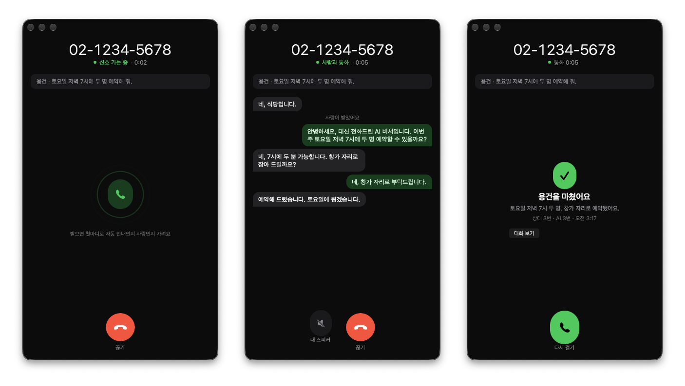

# AICall — AI 통화

**AI가 내 아이폰 번호로 대신 전화합니다. 맥에서 돌아갑니다.**

AI가 대신 걸어 주는 전화는 보통 그 서비스가 가진 번호로 나갑니다. 받는 쪽 화면에는 모르는 번호가 뜨고, 그래서 안 받거나 광고로 넘깁니다. AICall은 맥에 들어 있는 전화 앱으로 내 아이폰 회선을 씁니다. 상대 화면에는 내 번호가 뜹니다.

번호와 용건을 적으면 전화를 겁니다. 자동 안내가 받으면 번호를 누르고, 사람이 받으면 대화합니다.



[English README](README.en.md)

## 준비물

- 애플 실리콘 맥 + macOS 27, 언어는 한국어 (전화 앱 단추를 한국어 이름으로 찾습니다)
- 맥과 같은 애플 계정으로 로그인한 아이폰
- OpenAI API 키
- [홈브루](https://brew.sh)

## 설치

먼저 아이폰 전화를 맥에 연결해 둡니다. 맥의 전화 앱으로 한 통 걸어서 되는지 확인하세요. 순서는 **[처음 설정 안내](docs/setup-ko.md)**에 있습니다.

```bash
curl -fsSL https://raw.githubusercontent.com/gyujeongion/aicall/main/install.sh | zsh
```

끝나면 앱이 열리고 빠진 것을 물어봅니다. OpenAI 키, 전화에서 밝힐 내 이름, 내 번호입니다. 권한은 시스템 설정에서 직접 켭니다.

터미널이나 코딩 에이전트로 하려면 `aicall doctor`가 같은 점검표를 보여 주고, `aicall setup`이 같은 값을 저장합니다. 에이전트에게 맡길 때는 [AGENTS.md](AGENTS.md)를 읽히세요.

## 쓰는 법

**앱에서:** 번호나 맥 연락처의 이름을 넣고 용건을 적은 뒤 엔터를 누릅니다. 전에 걸었던 전화는 첫 화면의 최근 통화에서 눌러 다시 채웁니다. 받아쓴 내용이 실시간으로 올라오고, 언제든 끊을 수 있습니다. *통화 소리를 내 스피커로 듣기*를 끄면 글로만 봅니다.

**터미널이나 에이전트에서:**

```bash
aicall call 0212345678 "토요일 저녁 7시에 두 명 자리 있는지 물어봐 줘. 없으면 끝내." --follow
aicall call 엄마 "..." --follow          # 연락처 이름으로도 겁니다
aicall contacts 엄마                     # 이름으로 번호 찾기
aicall events --since 0 --wait 10       # 통화 이벤트 (JSON)
aicall press 1   ·   aicall say "..."   ·   aicall end success "요약"
```

`mcp_server.py`는 같은 기능을 MCP 도구(`call_start`, `call_events`, `call_press`, `call_say`, `call_end`, `call_status`)로 내놓습니다. 클로드 코드나 Codex 같은 에이전트가 전화를 걸고 중간에 끼어들 수 있습니다. 번호는 어떤 형식이든 받습니다: `01012345678`, `010 1234 5678`, `+82-10-1234-5678`.

## 원리


macOS 27에는 아이폰 회선으로 전화를 거는 **전화 앱**이 들어 있습니다. AICall은 인터넷 전화 서비스 대신 이 앱을 씁니다. 그래서 내 번호로 나갑니다.

1. **걸기** — 손쉬운 사용 API로 전화 앱에 번호를 넣고, 통화를 누르고, 키패드를 열고, 끊습니다. 화면 좌표나 마우스는 쓰지 않습니다.
2. **듣기** — 통화 소리를 스피커로 나가기 전에 시스템에서 바로 읽습니다.
3. **판단** — 첫 마디로 자동 안내인지 사람인지 가립니다. 자동 안내면 판단 모델이 안내가 나오는 중에 번호를 누릅니다. 사람이면 실시간 음성 모델이 AI 비서라고 밝히고 용건을 말합니다. 사람인 줄 알았는데 "1번을 눌러 주세요"가 나오면 다시 자동 안내로 넘깁니다.
4. **말하기** — AI 목소리는 가상 장치 *AICall Speaker*로 나가고, 전화 앱은 짝인 *AICall Mic*를 마이크로 씁니다.

통화마다 받아쓴 기록이 `~/Library/Application Support/AICall/calls/`에 남습니다. 녹음은 켰을 때만 남습니다.

사람과의 통화는 **GPT-Live**를 씁니다. 듣고 말하는 것을 한 모델이 해서 첫 대답이 1초쯤에 나옵니다. 다른 음성 모델을 붙이려면 [AGENTS.md](AGENTS.md)에 끼우는 자리가 적혀 있습니다.

## 지키는 것

- AI는 첫 마디에서 대신 전화한 AI 비서라고 밝힙니다.
- 말하는 개인정보는 내 이름과 번호뿐입니다. 주민번호, 생년월일, 카드, 계좌, 비밀번호는 말하지도 누르지도 않고, 직접 입력하라고 알립니다.
- 결제, 예약금, 계약은 하지 않습니다. 정해 준 범위를 벗어나면 요약을 남기고 끊습니다.
- 내 회선으로만 겁니다. 발신 번호를 바꾸지 않습니다.
- 음성 사서함, 전원 꺼짐, 통화 중 안내가 나오면 말하지 않고 끊습니다.

AI 음성 고지, 통화 녹음 동의, 광고 전화 규정은 나라마다 다릅니다. 거는 곳과 받는 곳의 법은 쓰는 사람이 확인해야 합니다. 녹음은 기본으로 꺼져 있습니다.

## 알아 둘 것

- 영어로 쓰는 맥에서는 아직 안 걸립니다.
- 통화하는 동안 맥이 켜져 있어야 하고, 그동안 내 아이폰 회선은 통화 중입니다.
- 비용은 OpenAI 사용량만큼 나갑니다.
- 앱은 설치할 때 이 맥에서 소스로 빌드합니다. 이 저장소가 미리 빌드해서 올려 둔 파일은 가상 오디오 장치 하나뿐이고, Xcode가 있으면 그것도 소스에서 빌드합니다.

## 테스트

```bash
PY=~/.config/aicall/venv/bin/python3   # 설치할 때 만든 파이썬 환경
$PY tests/test_live_gate.py   # 자동 안내/사람 판별, 말하는 타이밍, 끊김 처리 (오프라인)
$PY tests/test_runtime.py     # 엔진 실행부 (오프라인)
$PY tests/test_offline.py     # 실제 자동 안내 기록을 판단 모델에 다시 틀어 봅니다 (키 필요)
```

## 라이선스

MIT — [LICENSE](LICENSE). 가상 오디오 장치는 [BlackHole](https://github.com/ExistentialAudio/BlackHole)(GPL-3.0)을 고치지 않고 빌드한 것입니다. 소스는 이 저장소에 없고, `vmic/build_driver.sh`에 빌드 설정이 그대로 있습니다.
